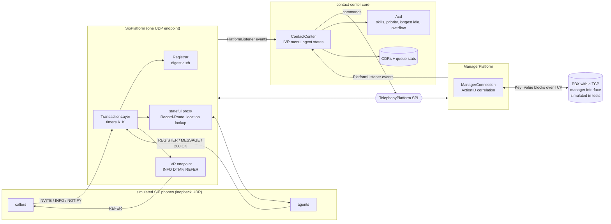

# sip-contact-center

A SIP-based contact center: SIP stack, registrar and proxy, automatic call distribution with skills-based routing, agent states, IVR and call detail records.


See also: [sip-video-cc](https://github.com/pgallo/sip-video-cc), the video side of the same story (SDP offer/answer for audio and video, RTP/RTCP media handling and a CSTA interface for third-party call control by commercial PBX platforms and agent desktops).

## What it demonstrates

- **A SIP stack written from scratch over UDP** (`java.net.DatagramSocket`, Java 21, no runtime dependencies): a parser and serializer for a subset of the RFC 3261 grammar (header folding, compact header names, comma-separated Via/Route/Record-Route/Contact, URI parameters and URI headers, Content-Length framing) that rejects malformed input instead of guessing.
- **Transaction state machines with every RFC 3261 timer**: INVITE and non-INVITE client and server transactions, Timers A, B, D, E, F, G, H, I, J and K, plus the Accepted state of RFC 6026. All timing goes through a `TimerService`, so tests drive the timers with a manual clock and assert retransmission instants to the millisecond.
- **Dialogs, registration and routing**: dialog state with route sets and CSeq ordering, REGISTER with binding expiry, digest authentication (RFC 2617, MD5 as in RFC 7616, qop=auth), and a transaction-stateful, record-routing proxy with location lookup.
- **Contact-center logic on top**: a DTMF-driven IVR (SIP INFO), queues with skills, minimum levels and priorities, longest-idle agent selection, overflow to a wider skill after a wait threshold, the agent state machine (LOGGED_OUT, READY, NOT_READY, ON_CALL, WRAP_UP), redirect on no answer, music-on-hold and prompt placeholders, call detail records and real-time queue statistics (service level, ASA, abandon rate).
- **Transfers with REFER**: the IVR hands each caller to an agent with REFER (RFC 3515); agents do blind transfers with REFER and attended transfers with a consultation call followed by REFER with Replaces (RFC 3891). One CDR follows the call across all agents.
- **Integration with open-source and commercial telephony platforms**: the core talks to a `TelephonyPlatform` SPI with two adapters, the SIP-native platform in this repository and a client for line-oriented TCP manager interfaces of the kind open-source PBXs expose (login, action/response correlation by ActionID, an event stream of `Key: Value` blocks, Originate and Redirect), tested against an in-process simulated PBX. Commercial PBX platforms are reached through CSTA in the companion repository.
- **Simulated traffic**: callers and agents are real SIP user agents in the same JVM over loopback UDP. The demo compresses a minute of contact-center activity into a few seconds; `--load` measures throughput.

## Architecture



The core (`cc` package) knows nothing about SIP. It receives `PlatformListener` events (incoming call, DTMF, agent connected or disconnected, call ended, agent commands) and issues `TelephonyPlatform` commands (play prompt, hold, connect to agent, hang up, originate). The SIP adapter is a single UDP endpoint that is registrar, proxy and IVR at once: callers reach the IVR user agent, which answers, collects DTMF over INFO and, when the ACD picks an agent, sends REFER with a correlation header inside the Refer-To URI. The caller's new INVITE goes through the proxy, which record-routes it, so every later BYE also passes through the proxy and becomes a per-agent disconnect event. The manager-interface adapter maps the same SPI onto actions (Redirect, Playback, MusicOnHold, Hangup, Originate) and events (Newchannel, DTMF, Bridge, Hangup, AgentLogin, AgentPaused). Everything runs on one event loop; socket reader threads only enqueue.

## Quickstart

Requires JDK 21. There are two equivalent build paths over the same standard Maven layout.

Dependency-free (only `javac` and `jar`):

```bash
./scripts/build.sh                       # builds build/sip-contact-center.jar
./scripts/demo.sh                        # ~60 s of simulated traffic over SIP, compressed 20x
./scripts/demo.sh --platform manager     # same core, same traffic model, over the PBX manager interface
./scripts/demo.sh --verbose --seed 3     # full event timeline, different random traffic
./scripts/demo.sh --load --calls 5000    # throughput run with short calls
./scripts/test.sh                        # builds, then runs all tests
```

`scripts/test.sh` uses a JUnit console launcher if one is installed under `/usr/share/java`; otherwise it compiles the same test sources against `tools/minitest`, a small source-compatible subset of the JUnit Jupiter API with its own runner.

With Maven (JUnit Jupiter 5.11 as the only test dependency):

```bash
mvn -B test
mvn -B package -DskipTests && java -jar target/sip-contact-center-0.1.0.jar
```

Excerpt of the default demo (seed 7):

```
SIP contact center on udp 127.0.0.1:58716, domain cc.test, 6 agents, 60 s simulated at 20x
agents registered (digest) and READY

    4.0s  C0001 arrives from caller01, IVR main
    5.6s  C0001 queued in general (IVR path 0)
    5.6s  C0001 routed general -> 2001 (Ana)
    7.3s  C0001 answered by 2001
   12.9s  C0002 queued in technical (IVR path 21)
   13.0s  C0002 routed technical -> 2002 (Ben)
   16.0s  C0001 now also with 2003 (transfer 1)
   18.3s  2001 leaves C0001, wrap-up
  ...
queue        offered answered abandoned overflow   SL(20s)   ASA(s)  abandon%
billing            7        6         1        3       29%     23.4       14%
technical          4        3         1        2       25%     33.8       25%
outage             0        0         0        0      100%      0.0        0%
sales              4        4         0        0      100%      2.3        0%
general            4        4         0        0       75%     11.8        0%

CDRs: 19 {ANSWERED=17, ABANDONED=2}, 4 transfers, avg wait 19.5 s, avg talk 25.8 s
SIP: 689 datagrams sent, 689 received, 0 malformed, 60 requests proxied
```

`--load --calls 2000` on a development container (24 agents, 32 caller lines, zero talk time):

```
load: 2000 calls (2000 answered by agents) in 2.33 s
      857 calls/s, 24859 SIP datagrams/s, 29.0 datagrams per call, 1 event-loop thread
```

Numbers vary slightly between runs: arrivals are seeded, but SIP timing over real sockets is not.

## Design decisions

1. **One event loop for every protocol element, with sockets only enqueuing.**
   *Why:* SIP state is spread over transactions, dialogs, registrations and the call model, and almost every event touches more than one of them. Running all of it on a single thread removes locking from the protocol code entirely and makes ordering explicit: a 200 OK that creates a leg is always processed before the NOTIFY that reports it. The load run shows one loop handles several hundred calls per second over loopback, far above what a single contact-center site needs.
   *Trade-off:* one slow callback stalls everything, and the design uses one core. Scaling out would mean sharding by Call-ID across loops, which the transaction layer allows (its maps are per instance) but the leg tracking in the proxy would then need a shared view.

2. **The proxy is record-routing and transaction-stateful, and it is where call legs are observed.**
   *Why:* a contact center needs to know when an agent is really in conversation and when they leave, including after transfers the core did not initiate. Forcing every contact-center dialog through the proxy with Record-Route means every 2xx to an INVITE and every BYE is visible in one place. Legs are keyed by Call-ID and grouped by a correlation header that travels inside the Refer-To URI (URI headers per RFC 3261 19.1.1), so a blind transfer, a consultation call and an INVITE with Replaces all land on the same contact-center call without any extra signalling.
   *Trade-off:* the proxy stays in the signalling path for the whole call and becomes a single point of failure; a production deployment would replicate it or keep leg state outside the process. The correlation header is trusted as sent by phones on the inside network.

3. **Transfers use REFER end to end instead of a back-to-back user agent.**
   *Why:* with REFER the media path stays between the caller and the agent and the server never relays RTP, which keeps the server small and matches how desk phones already do transfers. The IVR is just the first transferor: it answers, collects digits, then REFERs the caller to the chosen agent and drops its own leg on the NOTIFY 200. Attended transfer is a consultation dialog plus REFER with Replaces, and the target accepts the replacing INVITE and hangs up the consultation itself.
   *Trade-off:* the contact center depends on caller endpoints supporting REFER and Replaces. Many trunks do not, which is exactly why a B2BUA exists; the companion video repository takes that route. Failure handling also becomes asynchronous: a delivery failure is a NOTIFY with a sipfrag status, mapped to `connectFailed` and a requeue.

4. **A platform SPI with events in, commands out, and no exceptions for call outcomes.**
   *Why:* on both a SIP network and a PBX manager interface, the result of "connect this caller to that agent" is known only later and arrives as an event. Modelling it the same way in the SPI (`connectToAgent` returns nothing, failure comes back as `connectFailed`) let the ACD, IVR, agent state machine and statistics be written once and run unchanged over both adapters. The manager adapter correlates actions and responses with ActionID futures, and re-dispatches events onto the core's loop so the core stays single-threaded.
   *Trade-off:* the SPI is the lowest common denominator. Features one platform has and the other lacks (agent-initiated transfers on the SIP side, PBX-native queues on the manager side) are either kept outside the SPI or not used.

5. **Every timer behind an interface, scaled two ways.**
   *Why:* RFC 3261 behaviour is mostly about time: retransmission doubling, caps at T2, 64*T1 timeouts. Tests run each transaction type against a manual clock and check exact retransmission times, so a regression in Timer E capping or Timer H shows up as a precise diff. The demo uses the same interface differently: SIP timers on real time (so retransmission behaviour is realistic) and contact-center timers (ring time, talk time, wrap-up, overflow, IVR timeout) on a scaled clock that compresses minutes into seconds.
   *Trade-off:* two time bases in one process have to be kept apart carefully: CDR times are in simulated seconds, SIP timer values in real milliseconds.

6. **Service level counts calls abandoned after the threshold, not before.**
   *Why:* the indicators are defined in `QueueStats`: service level is answered within the threshold divided by answered plus abandoned after the threshold; calls that hang up in the first seconds are excluded because the queue never had a fair chance at them. ASA is total queue wait of answered calls over answered calls, abandon rate is abandoned over offered. Overflowed calls are counted separately so that a queue that looks healthy only because generalists absorb its overflow is visible.
   *Trade-off:* there are several industry definitions of service level, and this one flatters queues with many short abandons. It is easy to change in one place, but comparisons with other systems need the definition stated.

## Scope and limits

- UDP only; no TCP or TLS transport, no DNS (RFC 3263) resolution, IPv4 loopback in the demo. Strict routing is not supported, only loose routing with `;lr`.
- No CANCEL from the user agent side (a call hung up while ringing is cleared with BYE after the 2xx), no PRACK, no forking, no session timers. Re-INVITE is accepted but not generated.
- No media: SDP bodies are placeholders and prompts and music on hold are logged, not played. RTP and codec negotiation are covered in the companion repository.
- The registrar keeps one binding per address of record, in memory. Digest uses MD5 only (no SHA-256, no auth-int).
- The correlation header and agent state messages (`MESSAGE` with READY / NOT_READY / LOGOUT) are trusted; there is no authorization beyond registration.
- The simulated PBX models channels, bridging and hangup only. Agent-initiated transfers are exercised on the SIP side only.
- Queue, agent, caller and phone-number data are synthetic.

## About this lab

A compact reference implementation written in 2026. It reconstructs the approach behind a SIP contact center I built in 1999 and 2000, without reproducing any proprietary design.

## License

MIT, see [LICENSE](LICENSE).
